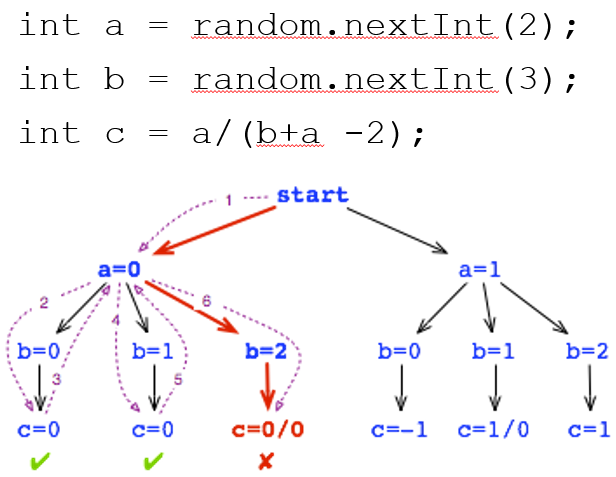

- [Introduction](#introduction)
- [Prerequisites](#prerequisites)
- [How to Run DrunkCarnivalShooter](#how-to-run-drunkcarnivalshooter)
- [Task 1: Apply JPF on Rand](#task-1-apply-jpf-on-rand)
- [Task 2: Apply JPF on DrunkCarnivalShooter](#task-2-apply-jpf-on-drunkcarnivalshooter)
  * [State Space Explosion](#state-space-explosion)
  * [Filtering Out State with @FilterField](#filtering-out-state-with-filterfield)
  * [Enumerating User Input with Verify](#enumerating-user-input-with-verify)
  * [Debugging the Exception Using the JPF Trace](#debugging-the-exception-using-the-jpf-trace)
  * [A Bug JPF Cannot See](#a-bug-jpf-cannot-see)
- [Task 3: Apply JPF on JUnit to Unit Test DrunkCarnivalShooter](#task-3-apply-jpf-on-junit-to-unit-test-drunkcarnivalshooter)
  * [Lessons on Model Checking](#lessons-on-model-checking)
- [Resources](#resources)

# Introduction

In this example, we will use a model checker named Java PathFinder (JPF) to
test a program.  Java PathFinder is a tool developed by NASA to model check
Java programs.  It works in exactly the same way we learned in class: it does
an exhaustive and systematic exploration of program state space to check for
correctness.  Unlike dynamic testing, which only checks the executions you
happen to try, this allows JPF to *prove* that certain correctness properties
hold for every execution over the inputs you ask it to explore, even for
programs with random behavior.

The program we will test is DrunkCarnivalShooter, a simple text-based game
where the player goes to a carnival shooting range and tries to win the prize
by shooting all 4 provided targets.  The player can designate what target to
shoot for by pressing 0-3.  But since the player is drunk, there is an equal
chance of the player shooting left or right as shooting straight.  Refer to the
file [sample_run.txt](sample_run.txt) for an example game play session.

# Prerequisites

You need Java 11 to run the Java PathFinder model checker, as well as Maven.
Make sure you have the correct Java version by doing "java -version" and
"javac -version" before you start.  Please refer to Exercise 0: Java
Assessment for instructions on how to install JDK 11 and set up your PATH
environment variable.

If you run JPF with the wrong Java version, it will fail in one of the
following ways.

On Java 8, the JVM does not even start, because it does not recognize the
--add-opens option used in the runApp and runTest scripts:

```
Unrecognized option: --add-opens
Error: Could not create the Java Virtual Machine.
Error: A fatal exception has occurred. Program will exit.
```

With some other Java versions, JPF terminates with a configuration error:

```
$ java --add-opens java.base/jdk.internal.misc=ALL-UNNAMED -jar build/RunJPF.jar Rand.jpf 
[SEVERE] JPF configuration error: error instantiating class gov.nasa.jpf.vm.OVHeap for entry "vm.heap.class":
> exception in gov.nasa.jpf.vm.OVHeap(gov.nasa.jpf.Config,gov.nasa.jpf.vm.KernelState):
>> java.lang.NoClassDefFoundError: sun/misc/SharedSecrets
> used within "vm.class" instantiation of class gov.nasa.jpf.vm.SingleProcessVM
[SEVERE] JPF terminated
```

On a newer Java such as Java 21, JPF does not report a configuration error.
Instead, it reports an error that looks like a bug in the program you are
checking:

```
====================================================== error 1
gov.nasa.jpf.vm.NoUncaughtExceptionsProperty
java.lang.NoSuchMethodError: jdk.internal.misc.Unsafe.getReferenceAcquire(Ljava/lang/Object;J)Ljava/lang/Object;
        at java.util.concurrent.ConcurrentHashMap.tabAt(ConcurrentHashMap.java:760)
        at java.util.concurrent.ConcurrentHashMap.putVal(ConcurrentHashMap.java:1018)
        at java.util.concurrent.ConcurrentHashMap.put(ConcurrentHashMap.java:1006)
        at java.util.Properties.put(Properties.java:1348)
        at java.lang.System.<clinit>(System.java:61)
```

That is also a sign that you are using the wrong Java version.  In all of these
cases, please check "java -version" again and retry after setting up Java 11.

# How to Run DrunkCarnivalShooter

You can try playing the game yourself using the reference implementation:

```
java -jar DrunkCarnivalShooter.jar
```

To run the DrunkCarnivalShooter using the current implementation, you first
need to compile it.

```
mvn compile
```

Then run the following commandline:

```
java -cp target/classes edu.pitt.cs.DrunkCarnivalShooterImpl
```

The current implementation contains several bugs.  Try repeatedly shooting the
first target by choosing 0.  At some point, you may see the game crash:

```
$ java -cp target/classes edu.pitt.cs.DrunkCarnivalShooterImpl
Round #0:  ||    ||    ||    ||
Choose your target (0-3):
0
You hit target #0! "The Force is strong with this one.", Darth opines.

Round #1:        ||    ||    ||
Choose your target (0-3):
0
You miss! "Do or do not. There is no try.", Yoda chides.

...

Round #3:        ||    ||    ||
Choose your target (0-3):
0
Exception in thread "main" java.lang.IndexOutOfBoundsException: Index -1 out of bounds for length 4
        ...
        at edu.pitt.cs.DrunkCarnivalShooterImpl.isTargetStanding(DrunkCarnivalShooterImpl.java:121)
        at edu.pitt.cs.DrunkCarnivalShooterImpl.takeDownTarget(DrunkCarnivalShooterImpl.java:106)
        at edu.pitt.cs.DrunkCarnivalShooterImpl.shoot(DrunkCarnivalShooterImpl.java:87)
        at edu.pitt.cs.DrunkCarnivalShooterImpl.main(DrunkCarnivalShooterImpl.java:162)
```

Or, you may encounter another bug where the game ends prematurely even when
there are targets remaining:

```
Round #2:        ||    ||    ||
Choose your target (0-3):
0
You aimed at target #0 but the Force pulls your bullet to the right.
You hit target #1! "The Force is strong with this one.", Darth opines.

You decimate all the targets. Where is my prize?
```

These bugs do not manifest in a deterministic way due to the randomness, so
which one you see (and when) depends on dumb luck.  This is the problem with
dynamic testing of nondeterministic programs: no matter how many times you
play, you can never be sure you have seen every behavior.  In this example,
we are going to use model checking to find these bugs systematically instead.

# Task 1: Apply JPF on Rand

Let's first try out JPF on the simple Rand program that we saw in the
"Static Analysis Part 2" lecture on model checking.



You have already compiled the code using "mvn compile", so let's get straight to running the code:

```
java -cp target/classes edu.pitt.cs.Rand
```

As we learned in the lecture, the program output is nondeterministic due to the
random number generation.  You have to rely on dumb luck to find the defect
which is the divide-by-zero exception on the calculation for "c".

Using JPF, you can *always* deterministically find the defect using systematic
state space exploration.

To run JPF on Rand, first cd into the jpf-core folder:
```
cd jpf-core
```

Then do (runApp.bat for Windows cmd shell, runApp.sh for Mac/Linux):

```
.\runApp.bat Rand.jpf
```
```
bash runApp.sh Rand.jpf
```

If you see any of the errors described in [Prerequisites](#prerequisites)
instead of the output below, you are not running Java 11.  If instead you see
the following, you have not compiled the code yet.  Run "mvn compile" from the
root directory and try again:

```
[WARNING] unknown classpath element: .../jpf-core/../target/classes
[SEVERE] cannot load application class edu.pitt.cs.Rand
```

If you see the following output, JPF is running correctly:

```
$ java --add-opens java.base/jdk.internal.misc=ALL-UNNAMED -jar build/RunJPF.jar Rand.jpf
JavaPathfinder core system v8.0 (rev 471fa3b7c6a9df330160844e6c2e4ebb4bf06b6c) - (C) 2005-2014 United States Government. All rights reserved.


====================================================== system under test
edu.pitt.cs.Rand.main()

====================================================== search started: 3/15/24 1:52 PM
computing c = a/(b+a - 2)..
a=0
  b=0       , a=0
=>  c=0     , b=0, a=0
  b=1       , a=0
=>  c=0     , b=1, a=0
  b=2       , a=0

====================================================== error 1
gov.nasa.jpf.vm.NoUncaughtExceptionsProperty
java.lang.ArithmeticException: division by zero
        at edu.pitt.cs.Rand.main(edu/pitt/cs/Rand.java:42)


====================================================== trace #1
------------------------------------------------------ transition #0 thread: 0
gov.nasa.jpf.vm.choice.ThreadChoiceFromSet {id:"ROOT" ,1/1,isCascaded:false}
      [3168 insn w/o sources]
  edu/pitt/cs/Rand.java:31       : System.out.println("computing c = a/(b+a - 2)..");
...
------------------------------------------------------ transition #1 thread: 0
gov.nasa.jpf.vm.choice.IntIntervalGenerator[id="verifyGetInt(II)",isCascaded:false,0..1,delta=+1,cur=0]
      [2 insn w/o sources]
  edu/pitt/cs/Rand.java:34       : int a = random.nextInt(2); // (2)
...
------------------------------------------------------ transition #2 thread: 0
gov.nasa.jpf.vm.choice.IntIntervalGenerator[id="verifyGetInt(II)",isCascaded:false,0..2,delta=+1,cur=2]
      [2 insn w/o sources]
  edu/pitt/cs/Rand.java:39       : int b = random.nextInt(3); // (3)
...
  edu/pitt/cs/Rand.java:42       : int c = a / (b + a - 2); // (4)
a=1
  b=0       , a=1
=>  c=-1     , b=0, a=1
  b=1       , a=1

====================================================== error 2
gov.nasa.jpf.vm.NoUncaughtExceptionsProperty
java.lang.ArithmeticException: division by zero
        at edu.pitt.cs.Rand.main(edu/pitt/cs/Rand.java:42)


====================================================== trace #2
------------------------------------------------------ transition #0 thread: 0
gov.nasa.jpf.vm.choice.ThreadChoiceFromSet {id:"ROOT" ,1/1,isCascaded:false}
      [3168 insn w/o sources]
  edu/pitt/cs/Rand.java:31       : System.out.println("computing c = a/(b+a - 2)..");
...
------------------------------------------------------ transition #1 thread: 0
gov.nasa.jpf.vm.choice.IntIntervalGenerator[id="verifyGetInt(II)",isCascaded:false,0..1,delta=+1,cur=1]
      [2 insn w/o sources]
  edu/pitt/cs/Rand.java:34       : int a = random.nextInt(2); // (2)
...
------------------------------------------------------ transition #2 thread: 0
gov.nasa.jpf.vm.choice.IntIntervalGenerator[id="verifyGetInt(II)",isCascaded:false,0..2,delta=+1,cur=1]
      [2 insn w/o sources]
  edu/pitt/cs/Rand.java:39       : int b = random.nextInt(3); // (3)
...
  edu/pitt/cs/Rand.java:42       : int c = a / (b + a - 2); // (4)
  b=2       , a=1
=>  c=1     , b=2, a=1

====================================================== results
error #1: gov.nasa.jpf.vm.NoUncaughtExceptionsProperty "java.lang.ArithmeticException: division by zero  a..."
error #2: gov.nasa.jpf.vm.NoUncaughtExceptionsProperty "java.lang.ArithmeticException: division by zero  a..."

====================================================== statistics
elapsed time:       00:00:00
states:             new=6,visited=3,backtracked=9,end=4
search:             maxDepth=3,constraints=0
choice generators:  thread=1 (signal=0,lock=1,sharedRef=0,threadApi=0,reschedule=0), data=3
heap:               new=950,released=52,maxLive=619,gcCycles=7
instructions:       3545
max memory:         979MB
loaded code:        classes=66,methods=1371

====================================================== search finished: 3/15/24 1:52 PM
```

Since both error and trace output are enabled in [jpf.properties](jpf-core/jpf.properties):

```
report.console.property_violation=error,trace
```

The console output will include a description of the error whenever a
property violation (e.g. an uncaught Java exception) occurs, as well as the execution
trace leading up to that error.

You can see from the screen output that JPF systematically explores all
possible states, thereby finding the two states with division-by-0 exception
errors.  So, now we know that there are two defective states, how do we
debug?  By looking at the trace corresponding to each error, you can see all
the Java statements executed leading up to the error and all the choices it
has made at points where there are nondeterministic choices.  The choices
are marked as "transitions" in the trace.

Let's take a close look at trace #1.  Transition #0 happens with
ThreadChoiceFromSet.  At this point JPF chooses one thread to start
executing out of all the threads in the program (to try out all the possible
thread interleavings as we discussed in class).  In this case, it is a
single-threaded program, so there is only one thread to choose from: the main
thread.

Transition #1 looks like the following:
```
gov.nasa.jpf.vm.choice.IntIntervalGenerator[id="verifyGetInt(II)",isCascaded:false,0..1,delta=+1,cur=0]
```
The IntIntervalGenerator enumerates all integers in a range of values and
goes down the program path for each generated integer.  You can see that it
was invoked in response to the following program statement:
```
  Rand.java:34                   : int a = random.nextInt(2); // (2)
```
What JPF does is to generate two integers in the range "0..1" with a delta
of 1, so two integers 0 and 1.  It will try out both possibilities.  The
current choice is given in "cur=0".  So you can tell that the error occurred
when "int a = 0;".

If you follow trace #1 using this logic, you can tell that the first
divide-by-zero exception occurred when a = 0 and b = 2.  If you follow
trace #2, you can tell that the second exception occurred when a = 1 and b = 1.
In this way, even without the help of program output, you can trace through
the code and identify why each error occurred.

# Task 2: Apply JPF on DrunkCarnivalShooter

Now let's once again work on DrunkCarnivalShooter.  Stay in the jpf-core
folder, since that is where the JPF scripts and DrunkCarnivalShooter.jpf are.

## State Space Explosion

To run JPF on DrunkCarnivalShooter do (.bat for Windows, .sh for Mac/Linux),
but be ready to quickly press Ctrl+C:

```
.\runApp.bat DrunkCarnivalShooter.jpf
```
```
bash runApp.sh DrunkCarnivalShooter.jpf
```

Press Ctrl+C now, or your process is going to run out of memory!  JPF never
finishes, and the rounds keep going on and on:

```
JavaPathfinder core system v8.0 (rev 1a704e1d6c3d92178504f8cdfe57b068b4e22d9c) - (C) 2005-2014 United States Government. All rights reserved.


====================================================== system under test
edu.pitt.cs.DrunkCarnivalShooterImpl.main("test")

====================================================== search started: 10/21/26, 2:03 PM
[WARNING] orphan NativePeer method: jdk.internal.misc.Unsafe.getUnsafe()Lsun/misc/Unsafe;
Round #0:  ||    ||    ||    ||  
Choose your target (0-3): 
You aimed at target #1 but the Force pulls your bullet to the left.
You hit target #0! "The Force is strong with this one.", Darth opines.

Round #1:        ||    ||    ||  
Choose your target (0-3): 
You aimed at target #1 but the Force pulls your bullet to the left.
You miss! "Do or do not. There is no try.", Yoda chides.

Round #2:        ||    ||    ||  
Choose your target (0-3): 
You aimed at target #1 but the Force pulls your bullet to the left.
You miss! "Do or do not. There is no try.", Yoda chides.

Round #3:        ||    ||    ||  
Choose your target (0-3): 
You aimed at target #1 but the Force pulls your bullet to the left.
You miss! "Do or do not. There is no try.", Yoda chides.
...
```

It looks like JPF keeps coming back to the same state, with 3 targets
standing.  That is because by default JPF does a Depth-First Search (DFS) of
the state space.  At each choice, it takes the first ("left-most") option,
which here is the random number generator pulling the bullet to the left, and
keeps going deeper and deeper until it can proceed no further.

But although it appears like JPF is coming back to the same state, it is not.
If it were the same state, JPF would have detected a state match: it would
know that it has already explored everything reachable from that state, so it
would backtrack and move on to some other choice, such as the bullet going
straight.  Note that an infinite loop by itself does not mean an infinite
number of states.  So something must be causing a new state to be created at
each round.  What is different from round to round?  Take a close look at the
output before reading on.

## Filtering Out State with @FilterField

It is the round number!  The round number is just a counter statistic, and it
is not central to verifying the game logic.  The state that we are really
interested in is the state of the 4 targets.  Now if you think about it, the 4
targets can only be in a handful of states: 2 * 2 * 2 * 2 = 16 states
(standing or toppled for each).  And this is true no matter how many rounds
you go through.  The round number, which changes every single round, is the
culprit leading to the state explosion.  So, let's filter that state out!

Import the appropriate JPF library at the top of DrunkCarnivalShooterImpl.java:

```
import gov.nasa.jpf.annotation.FilterField;
```

And now, let's annotate roundNum such that it is filtered out:

```
@FilterField private int roundNum;
```

Now JPF will ignore roundNum when comparing states.  Let's recompile (from the
root directory):

```
mvn compile
```

And try running JPF one more time (from the jpf-core folder):

```
.\runApp.bat DrunkCarnivalShooter.jpf
```
```
bash runApp.sh DrunkCarnivalShooter.jpf
```

This time, JPF terminates after a handful of rounds and declares that there
are no errors:

```
====================================================== results
no errors detected
```

## Enumerating User Input with Verify

But wait, didn't the game sometimes crash with an exception when we played it
in [How to Run DrunkCarnivalShooter](#how-to-run-drunkcarnivalshooter)?  Why is
JPF not detecting the exception?

That is because in the DrunkCarnivalShooterImpl main method, if the argument
"test" is passed (meaning that we are in JPF test mode), I removed all
calls to Scanner which scans user input, and hard coded the user selected
target to "1" when in test mode.  That is why every round in the above log
says "You aimed at target #1":

```
Scanner scanner = null;
if (args.length == 1 && args[0].equals("test")) {
    // Do not create an input scanner when running with JPF.
} else {
    scanner = new Scanner(System.in);
}
while (true) {
    System.out.println(shooter.getRoundString());
    System.out.println("Choose your target (0-3): ");
    int t = 1;
    if (scanner == null) {
        // TODO: Enumerate all possible values of t using JPF Verify.
    } else {
        t = scanner.nextInt();
    }
    // Shoot the target
    ...
}
```

Why did I have to do this?  That is because JPF is not designed to take user
input.  If it were to take user input, then the test coverage of JPF will be
beholden to what input the user chooses.  The goal of JPF (and any other
model checker) is to verify the program **regardless of user input**.

JPF provides a set of APIs under the Verify class (gov.nasa.jpf.vm.Verify)
to specify the set of user input(s) we want to test.  Then, it **exhaustively
tests the program for each user input**, by creating a new path to explore
for each input.

In order to be able to use the Verify APIs, we first have to import the class
at the top of DrunkCarnivalShooterImpl.java:

```
import gov.nasa.jpf.vm.Verify;
```

In terms of the code, all you have to do is on the // TODO comment, call:

```
t = Verify.getInt(0, 3);
```

The above will direct JPF to generate 4 states each where t is set to 0, 1, 2,
or 3 respectively.  Then it will systematically explore each state.  If you
wish, you can test a larger set of numbers beyond 0-3.  It is just going to
generate more states and take longer (the flipside being you will be able to
model check your program against a larger set of inputs).

Now let's recompile (from the root directory):

```
mvn compile
```

And try running JPF one more time (from the jpf-core folder):

```
.\runApp.bat DrunkCarnivalShooter.jpf
```
```
bash runApp.sh DrunkCarnivalShooter.jpf
```

## Debugging the Exception Using the JPF Trace

This time, JPF shows an error message due to an exception (line numbers in
your output may differ depending on your code):

```
====================================================== search started: 3/15/24 4:24 PM
Round #0:  ||    ||    ||    ||  
Choose your target (0-3):

====================================================== error 1
gov.nasa.jpf.vm.NoUncaughtExceptionsProperty
java.lang.ArrayIndexOutOfBoundsException: -1
        at java.util.ArrayList.elementData(java/util/ArrayList.java:424)
        at java.util.ArrayList.get(java/util/ArrayList.java:437)
        at edu.pitt.cs.DrunkCarnivalShooterImpl.isTargetStanding(edu/pitt/cs/DrunkCarnivalShooterImpl.java:127)
        at edu.pitt.cs.DrunkCarnivalShooterImpl.takeDownTarget(edu/pitt/cs/DrunkCarnivalShooterImpl.java:111)
        at edu.pitt.cs.DrunkCarnivalShooterImpl.shoot(edu/pitt/cs/DrunkCarnivalShooterImpl.java:92)
        at edu.pitt.cs.DrunkCarnivalShooterImpl.main(edu/pitt/cs/DrunkCarnivalShooterImpl.java:173)
...
```

Wait, this is the same out-of-bounds bug that we randomly experienced
previously!  (JPF reports it as an ArrayIndexOutOfBoundsException instead of an
IndexOutOfBoundsException, but it is the same index -1 problem.)  Use
the trace generated as part of the output to find the input value(s) and the
random value(s) that led to the exception.  Interpret it in the same way you
did the Rand trace.  The trace should look like the following (line numbers in
your output may differ depending on your code):

```
====================================================== trace #1
------------------------------------------------------ transition #0 thread: 0
gov.nasa.jpf.vm.choice.ThreadChoiceFromSet {id:"ROOT" ,1/1,isCascaded:false}
      [6345 insn w/o sources]
  edu/pitt/cs/DrunkCarnivalShooterImpl.java:153 : DrunkCarnivalShooterImpl shooter = new DrunkCarnivalShooterImpl();
...
------------------------------------------------------ transition #1 thread: 0
gov.nasa.jpf.vm.choice.IntIntervalGenerator[id="verifyGetInt(II)",isCascaded:false,0..3,delta=+1,cur=0]
      [2 insn w/o sources]
  edu/pitt/cs/DrunkCarnivalShooterImpl.java:166 : t = Verify.getInt(0, 3);
...
------------------------------------------------------ transition #2 thread: 0
gov.nasa.jpf.vm.choice.IntIntervalGenerator[id="verifyGetInt(II)",isCascaded:false,0..2,delta=+1,cur=0]
      [2 insn w/o sources]
  edu/pitt/cs/DrunkCarnivalShooterImpl.java:48 : int offsetNum = rand.nextInt(3) - 1;
...
```

The trace represents all the Java instructions that have executed up to the
point of the failure.  Now let's try to break down that trace.  A transition
happens in the course of traversing the program state space.  Whenever there
is a "choice" between one or more program states, a transition is recorded with
the selected choice.  When is JPF presented with a choice?

1. When it encounters Verify.getInt, it is presented with a range of user
   inputs each of which represents a separate path that JPF can take.  Same
thing applies to all the other Verify APIs.

1. When it encounters Random.nextInt, it is presented with a range of random
   values that the random number generator can return, each of which again
represents a different program state.

1. When the program is multithreaded (parallel), JPF is also presented at each
   instruction with a choice of whether to context switch and execute another
thread.  This is what transition #0 is.  This is how JPF can exhaustively
explore all thread interleavings.  You will be an example of JPF making a
choice between multiple threads when you do the exercise. :)

In the above trace, it is important to understand transitions #1 and #2.  What
would be transition #1 with choice interval 0..3?  It would be the
Verify.getInt(0, 3) that replaced the scan of user input.  And according to the
trace it returned 0 ("cur=0").  What would be transition #2 with choice
interval 0..2?  It would be the rand.nextInt(3) used to add randomness to the
shooting target, and in the trace it also returned 0 ("cur=0").  So it's the
case where the user chose target 0 and the randomness of the shooting pulled
the bullet to the left.  What's on the left side of target 0?  That should help
you track down the problem.  **Hint: What happens when t becomes -1 in isTargetStanding?**

## A Bug JPF Cannot See

Once you fix the bug (remember that the bullet can also veer right of target
#3), recompile from the root directory:

```
mvn compile
```

Then run JPF again from the jpf-core folder:

```
.\runApp.bat DrunkCarnivalShooter.jpf
```
```
bash runApp.sh DrunkCarnivalShooter.jpf
```

JPF should once again declare "no errors detected".  So is the game correct
now?  Try playing it a few times:

```
java -cp target/classes edu.pitt.cs.DrunkCarnivalShooterImpl
```

You will notice that the game sometimes ends prematurely, declaring "You
decimate all the targets" even when there are targets remaining.  In fact, the
same thing happens in the JPF output.  Look for "You decimate all the targets"
in the output.  The round string printed just before it shows three targets
standing, and only one of them gets hit, so the game terminates even when two
targets are still standing.  So the game now does not throw any exceptions but
still malfunctions.

Why did JPF not catch this?  The property that the game ends only when all the
targets are down is specific to this program, and JPF knows nothing about it.

JPF can only check for the system properties it is configured to check while
traversing the program state space.  In
[DrunkCarnivalShooter.jpf](jpf-core/DrunkCarnivalShooter.jpf), only
NoUncaughtExceptionsProperty (the program never throws an uncaught exception)
is enabled.  The file also lists, commented out, the other checks JPF provides,
such as deadlocks, data races, and endless loops.
If you want to check that your program behaves in a certain way according to
the requirements, you need to tell JPF about these additional properties.  The
way to encode properties is through assertions that assert the given invariant
property at that point of execution.  There are two options to insert these
assertions:

1. The assertions can be embedded in your program code in the form of Java
   assert statements (which, as in the regular JVM, JPF ignores unless you
enable them with vm.enable_assertions in the .jpf file).  It is sometimes
useful to have these assertions checked while your system is deployed in the
production site, especially if
the assertions can prevent a catastrophic event.  But this has the drawback
that your testing code is mixed in with your implementation code which is
not good for code readability and/or maintenance.  

1. The other option is to use JPF as part of the JUnit testing framework.
   JUnit will check for defects by checking postconditions using JUnit
assertions, just like with regular unit testing.  But each of the JUnit tests
become comprehensive and exhaustive thanks to JPF, even in the face of random
program behavior.  JPF makes sure that the invariant assertion holds for all
the random behaviors the program can display.  It also does this for all
possible user inputs if the Verify API is used.

We will choose the latter option.

# Task 3: Apply JPF on JUnit to Unit Test DrunkCarnivalShooter

In this section, we are going to be working on the
DrunkCarnivalShooterTest.java JUnit class, and in order to recompile the
code after modifications, you need to do (from the root directory):

```
mvn test-compile
```

Invoking the Maven test-compile phase will build the JUnit files under the
src/test directory, along with the implementation files under the src/main
directory.

To run JPF on DrunkCarnivalShooterTest, do (.bat for Windows, .sh for Mac/Linux) from the jpf-core folder:

```
.\runTest.bat edu.pitt.cs.DrunkCarnivalShooterTest
```
```
bash runTest.sh edu.pitt.cs.DrunkCarnivalShooterTest
```

Run this test only with runTest, not from the VS Code Testing panel, which can
report it as passing even when JPF never ran.

As of now, it should show one test method "testShoot" passing:

```
$ java --add-opens java.base/jdk.internal.misc=ALL-UNNAMED -jar build/RunTest.jar edu.pitt.cs.DrunkCarnivalShooterTest

......................................... testing testShoot()
  running jpf with args:
JavaPathfinder core system v8.0 (rev 1a704e1d6c3d92178504f8cdfe57b068b4e22d9c) - (C) 2005-2014 United States Government. All rights reserved.


====================================================== system under test
edu.pitt.cs.DrunkCarnivalShooterTest.runTestMethod()

====================================================== search started: 3/19/24, 1:34 AM
[WARNING] orphan NativePeer method: jdk.internal.misc.Unsafe.getUnsafe()Lsun/misc/Unsafe;
Failure in Round #0:                         (targetChoice=0):

====================================================== results
no errors detected

====================================================== search finished: 3/19/24, 1:34 AM
......................................... testShoot: Ok

......................................... execution of testsuite: edu.pitt.cs.DrunkCarnivalShooterTest SUCCEEDED
.... [1] testShoot: Ok
......................................... tests: 1, failures: 0, errors: 0

tested classes: 1, passed: 1
```

As of now, DrunkCarnivalShooterTest.java is incomplete and does not do much.
Fill in the locations with // TODO comments inside.  In the setUp method, use
the Verify API such that you enumerate all the 16 possible states that the game
can be in, as well as the target choice made by the user (0-3).  In this way,
each of your JUnit test cases will be tested on all possible states the game
can be in with all possible user inputs.

In the testShoot() method, implement the preconditions, execution steps, and
the invariant to test the shoot(targetChoice, builder) method as explained in
the method comment.  The invariant is a property that must hold no matter the
game state and the target choice.  For this test, the invariant chosen was the
remaining number of targets, because it appears that the game is ending
prematurely thinking that there aren't any more targets.

I recommend that you always insert the failString that I initialized for you in
the testShoot method as the first argument of any JUnit assert call so that you get
that as part of your failure message.  For example,

```
assertEquals(failString, expected value, observed value);
```

The failString tells you the combination of game state and target choice that
led to the failure, which helps you debug the problem.  Feel free to append
additional information to the failString that may help you debug.

Now, try running the JUnit test again on top of JPF:

```
.\runTest.bat edu.pitt.cs.DrunkCarnivalShooterTest
```
```
bash runTest.sh edu.pitt.cs.DrunkCarnivalShooterTest
```

If you implemented the test properly, it should produce an assertion failure
and the trace leading up to it (again, line numbers may differ):

```
$ java --add-opens java.base/jdk.internal.misc=ALL-UNNAMED -jar build/RunTest.jar edu.pitt.cs.DrunkCarnivalShooterTest

......................................... testing testShoot()
  running jpf with args:
JavaPathfinder core system v8.0 (rev 1a704e1d6c3d92178504f8cdfe57b068b4e22d9c) - (C) 2005-2014 United States Government. All rights reserved.


====================================================== system under test
edu.pitt.cs.DrunkCarnivalShooterTest.runTestMethod()

====================================================== search started: 3/19/24, 2:08 AM
[WARNING] orphan NativePeer method: jdk.internal.misc.Unsafe.getUnsafe()Lsun/misc/Unsafe;

====================================================== error 1
gov.nasa.jpf.vm.NoUncaughtExceptionsProperty
java.lang.AssertionError: Failure in Round #0:        ||               (targetChoice=0):
        at gov.nasa.jpf.util.test.TestJPF.fail(gov/nasa/jpf/util/test/TestJPF.java:164)
        at gov.nasa.jpf.util.test.TestJPF.assertEquals(gov/nasa/jpf/util/test/TestJPF.java:1054)
        at edu.pitt.cs.DrunkCarnivalShooterTest.testShoot(edu/pitt/cs/DrunkCarnivalShooterTest.java:126)
        at java.lang.reflect.Method.invoke(gov.nasa.jpf.vm.JPF_java_lang_reflect_Method)
        at gov.nasa.jpf.util.test.TestJPF.runTestMethod(gov/nasa/jpf/util/test/TestJPF.java:648)


====================================================== trace #1
------------------------------------------------------ transition #0 thread: 0
gov.nasa.jpf.vm.choice.ThreadChoiceFromSet {id:"ROOT" ,1/1,isCascaded:false}
...
------------------------------------------------------ transition #1 thread: 0
gov.nasa.jpf.vm.choice.IntIntervalGenerator[id="verifyGetInt(II)",isCascaded:false,0..3,delta=+1,cur=0]
...
------------------------------------------------------ transition #2 thread: 0
gov.nasa.jpf.vm.BooleanChoiceGenerator[[id="verifyGetBoolean",isCascaded:false,{>false,true}]
...
------------------------------------------------------ transition #3 thread: 0
gov.nasa.jpf.vm.BooleanChoiceGenerator[[id="verifyGetBoolean",isCascaded:false,{false,>true}]
...
------------------------------------------------------ transition #4 thread: 0
gov.nasa.jpf.vm.BooleanChoiceGenerator[[id="verifyGetBoolean",isCascaded:false,{>false,true}]
...
------------------------------------------------------ transition #5 thread: 0
gov.nasa.jpf.vm.BooleanChoiceGenerator[[id="verifyGetBoolean",isCascaded:false,{>false,true}]
...
------------------------------------------------------ transition #6 thread: 0
gov.nasa.jpf.vm.choice.IntIntervalGenerator[id="verifyGetInt(II)",isCascaded:false,0..2,delta=+1,cur=2]
      [2 insn w/o sources]
  edu/pitt/cs/DrunkCarnivalShooterImpl.java:49 : int offsetNum = rand.nextInt(3) - 1;
...
  edu/pitt/cs/DrunkCarnivalShooterImpl.java:114 : remainingTargetNum--;
...
  edu/pitt/cs/DrunkCarnivalShooterImpl.java:95 : remainingTargetNum--;
...

====================================================== results
error #1: gov.nasa.jpf.vm.NoUncaughtExceptionsProperty "java.lang.AssertionError: Failure in Round #0:    ..."

====================================================== search finished: 3/19/24, 2:08 AM
java.lang.AssertionError: JPF found unexpected errors: gov.nasa.jpf.vm.NoUncaughtExceptionsProperty
        at gov.nasa.jpf.util.test.TestJPF.fail(TestJPF.java:164)
        at gov.nasa.jpf.util.test.TestJPF.noPropertyViolation(TestJPF.java:816)
        at gov.nasa.jpf.util.test.TestJPF.verifyNoPropertyViolation(TestJPF.java:830)
        at edu.pitt.cs.DrunkCarnivalShooterTest.testShoot(DrunkCarnivalShooterTest.java:79)
        at java.base/jdk.internal.reflect.NativeMethodAccessorImpl.invoke0(Native Method)
        at java.base/jdk.internal.reflect.NativeMethodAccessorImpl.invoke(NativeMethodAccessorImpl.java:62)
        at java.base/jdk.internal.reflect.DelegatingMethodAccessorImpl.invoke(DelegatingMethodAccessorImpl.java:43)
        at java.base/java.lang.reflect.Method.invoke(Method.java:566)
        at gov.nasa.jpf.util.test.TestJPF.invoke(TestJPF.java:499)
        at gov.nasa.jpf.util.test.TestJPF.runTests(TestJPF.java:558)
        at java.base/jdk.internal.reflect.NativeMethodAccessorImpl.invoke0(Native Method)
        at java.base/jdk.internal.reflect.NativeMethodAccessorImpl.invoke(NativeMethodAccessorImpl.java:62)
        at java.base/jdk.internal.reflect.DelegatingMethodAccessorImpl.invoke(DelegatingMethodAccessorImpl.java:43)
        at java.base/java.lang.reflect.Method.invoke(Method.java:566)
        at gov.nasa.jpf.tool.RunTest.main(RunTest.java:185)
......................................... test method failed with: JPF found unexpected errors: gov.nasa.jpf.vm.NoUncaughtExceptionsProperty
......................................... testShoot: Failed

......................................... execution of testsuite: edu.pitt.cs.DrunkCarnivalShooterTest FAILED
.... [1] testShoot: Failed
......................................... tests: 1, failures: 1, errors: 0
```

Through this trace you can see what choices were made on this path,
starting from generation of the targetChoice and target states, ending in the
random number generation for the fuzzing.  You can also see on the 
trace remainingTargetNum, a key variable in this defect, getting decremented
twice.

Debug DrunkCarnivalShooterImpl using this trace, then run
DrunkCarnivalShooterTest one more time:

```
.\runTest.bat edu.pitt.cs.DrunkCarnivalShooterTest
```
OR
```
bash runTest.sh edu.pitt.cs.DrunkCarnivalShooterTest
```

JPF should no longer find any test failures.  The output should look like the
passing output shown at the beginning of this task, without the "Failure in
Round #0" line (assuming you commented out the println as instructed in the
test).  Now if you play the game, you should not see any defects.

## Lessons on Model Checking

What have we learned?  We learned that a model checker such as JPF can
guarantee correctness for the given set of inputs.  But in order to do that,
you often need to limit the amount of state JPF monitors to prevent state
explosion.  Also, the guarantee of correctness depends heavily on how much of
the program specification you have encoded into your testing in the form of
assertions.  If there are no assertions, JPF can only check basic things
such as no exceptions.

# Resources

* Java PathFinder wiki:  
https://github.com/javapathfinder/jpf-core/wiki

* Java PathFinder manual:  
https://github.com/javapathfinder/jpf-core/wiki/How-to-use-JPF

* Java PathFinder Verify API:  
https://github.com/javapathfinder/jpf-core/wiki/Verify-API-of-JPF
